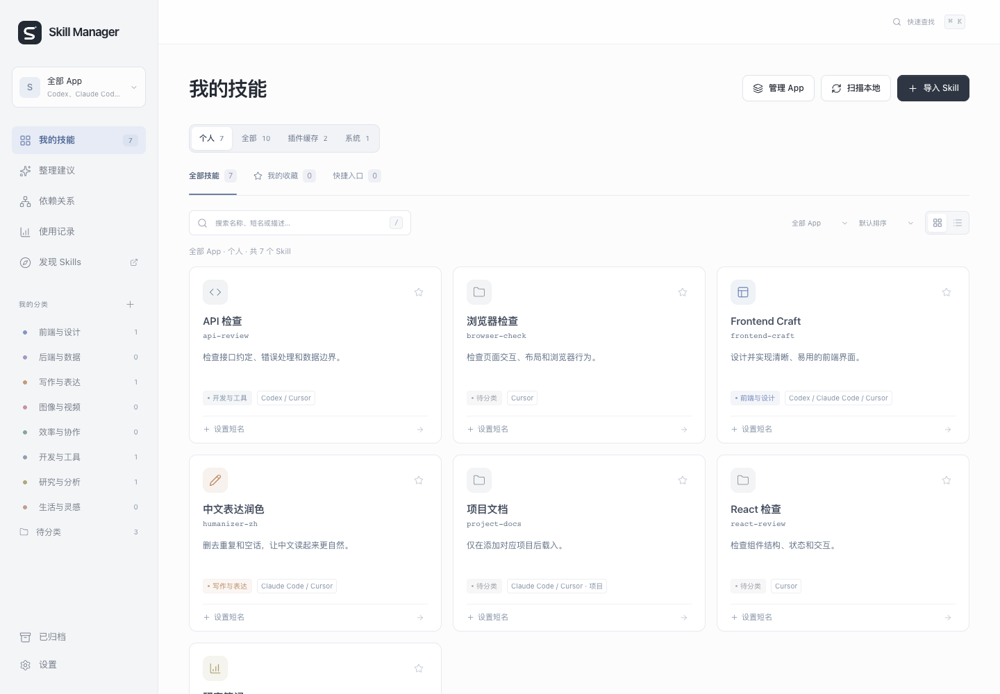

# Skill Manager

[](https://github.com/yanlin-zhou/skill-manager/actions/workflows/ci.yml)

A local workspace for a growing Codex Skill library. Find the right Skill, give it a memorable name, and inspect its relationships.

[简体中文](README.zh-CN.md) · [Releases](https://github.com/yanlin-zhou/skill-manager/releases) · [Report an issue](https://github.com/yanlin-zhou/skill-manager/issues)



The current interface is Simplified Chinese.

## Quick start

Requires **Node.js 22+**. No dependencies or build step.

```sh
git clone https://github.com/yanlin-zhou/skill-manager.git
cd skill-manager
npm start
```

Open **http://127.0.0.1:4317** on the same computer. The server listens on loopback only.

On macOS, `./start.command` starts a background service and opens the page. `./start.command --no-open` skips opening the browser. Update an existing background service after pulling changes with:

```sh
launchctl kickstart -k "gui/$(id -u)/com.thomas.skill-manager"
```

The legacy service label and health `app` identifier are retained for compatibility. Foreground startup works on macOS and Linux; the macOS launcher is platform-specific. Use `PORT=4319 npm start` for a different foreground port. Windows has not been verified.

## Try the demo

```sh
npm run demo
```

Open **http://127.0.0.1:4318**. It generates isolated sample Skills and configuration in a temporary directory. The screenshot above uses this demo, not a personal library. Stop it with Ctrl+C.

## What it does

- Scans `~/.codex/skills`, `~/.agents/skills`, Codex plugin caches and manager imports.
- Defaults to personal Skills. Switch to all sources, plugin caches or system Skills; search and counts share the selected scope.
- Searches names, descriptions, notes and short names. Includes categories, favorites, grid/list views and `⌘K` / `Ctrl+K` quick search.
- Sets display names and short names. Explicitly creates a `$short-name` entry without overwriting an existing different file.
- Shows file references, compatibility aliases and manually recorded dependencies. Detects identical bodies, same-name sources, missing references and changed dependency version records.
- Supports manual usage records, local configuration export/import and optional GitHub popularity lookup.

## Data and limits

Your catalog stays on your computer. Configuration and imports live in `.skill-manager/`, which is gitignored. The app does not upload your Skills or read Codex chat logs. It makes outbound requests only when you refresh public GitHub repository popularity.

- Plugin cache presence does not prove a plugin is enabled.
- A saved short name is not an installed entry; calls are offered only with matching local evidence from the latest scan. Rescan after changing files.
- Importing `SKILL.md` does not install its scripts or assets. Install complete Skills separately before use.
- Dependencies are references or manual records. Updating a version record does not upgrade source files or packages.
- Upstream update checks and automatic usage tracking are not implemented. No records does not mean unused.
- Archive hides an entry in this manager; it does not disable or delete a Codex Skill.
- There is no remote-access, login or hosted-library mode. `127.0.0.1` on another computer will not reach this service.

## Development

```sh
npm run dev
npm run check
npm test
bash -n start.command
```

Tests use temporary fixtures rather than installed Skills. CI checks Node 22 and 24 on macOS and Linux. See [Contributing](CONTRIBUTING.md), [Security](SECURITY.md) and [Community conduct](CODE_OF_CONDUCT.md).

## Roadmap

Scenario favorites and verifiable upstream update sources come next. See the [product review](docs/product-review.md), [UX review](docs/ux-review.md) and [Changelog](CHANGELOG.md).

## License

[MIT](LICENSE). Bundled icon notices are in [THIRD_PARTY_NOTICES.md](THIRD_PARTY_NOTICES.md). Installed Skills keep their own licenses and are not bundled with the manager. The package is marked `private` only to prevent accidental npm publication.

This is an independent community project, not an official OpenAI product. Public history begins at v0.4.0; earlier development history remains private.
