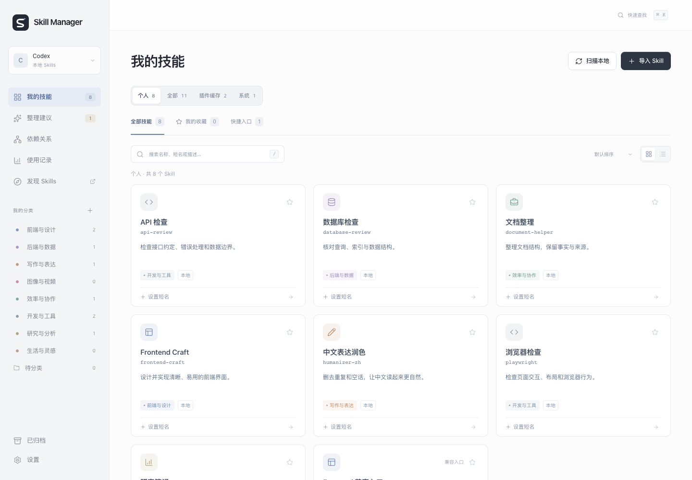

# Codex Skill Manager

本地 Codex Skills 管理台。找到需要的 Skill，设置好记的名称，查看引用、依赖和待核对项。

[English](README.md) · [版本发布](https://github.com/yanlin-zhou/codex-skill-manager/releases) · [反馈问题](https://github.com/yanlin-zhou/codex-skill-manager/issues)



## 开始使用

需要 **Node.js 22 或更新版本**，无需安装依赖或构建。

```sh
git clone https://github.com/yanlin-zhou/codex-skill-manager.git
cd codex-skill-manager
npm start
```

在运行服务的同一台电脑打开 **http://127.0.0.1:4317**。另一台电脑上的 `127.0.0.1` 指向另一台电脑。

macOS 可运行 `./start.command` 启动后台服务并打开页面；`./start.command --no-open` 仅启动。更新代码后，重启已有后台服务：

```sh
launchctl kickstart -k "gui/$(id -u)/com.thomas.skill-manager"
```

服务标签及健康接口的旧 `app` 标识为兼容已有安装而保留。macOS、Linux 可前台运行；Windows 尚未验证。前台运行可用 `PORT=4319 npm start` 换端口。启动日志保存在 `.skill-manager/server.log` 和 `.skill-manager/server-error.log`。

## 先看演示

```sh
npm run demo
```

打开 **http://127.0.0.1:4318**。演示会在临时目录生成独立样本，不读取或修改已安装的 Skills；上图也来自该演示。Ctrl+C 停止。

## 功能

- 扫描 `~/.codex/skills`、`~/.agents/skills`、插件缓存及工作台导入目录。
- 默认显示个人 Skills，明确切换全部、缓存或系统范围；搜索、分类及计数保持一致。
- 按名称、描述、短名和备注搜索；支持分类、收藏、卡片／列表、`⌘K`／`Ctrl+K` 快速查找。
- 设置显示名称和短名；明确创建 Codex `$短名` 入口，不覆盖已有不同文件。
- 查看文件引用、兼容入口和手动依赖；核对正文一致、同名来源、缺失引用及依赖版本记录变化。
- 手动使用记录、配置备份与恢复、按需读取 GitHub 公开仓库热度。

## 数据与边界

配置和导入文件保存在 `.skill-manager/`，默认排除在 Git 之外。目录不上传，也不读取 Codex 聊天记录。只有刷新公开仓库热度时会请求 GitHub。

- 插件缓存不代表已启用；归档仅在管理台隐藏，不会禁用或删除源 Skill。
- 保存短名不等于创建入口。调用信息依据最近扫描；文件变化后需重新扫描。
- 导入单个 `SKILL.md` 不等于完整安装；脚本、引用资料和资源需另外完整安装。
- 手动依赖及版本记录不修改或升级源文件；尚未核对上游更新。
- 使用数据仅来自手动记录，无记录不代表从未使用。
- 当前没有账户、远程访问或托管技能库。

## 开发与贡献

```sh
npm run dev
npm run check
npm test
bash -n start.command
```

测试使用隔离样本；CI 覆盖 macOS、Linux 和 Node 22／24。参见[贡献指南](CONTRIBUTING.md)、[安全报告](SECURITY.md)、[行为准则](CODE_OF_CONDUCT.md)。

[产品评估](docs/product-review.md)与 [UX 评估](docs/ux-review.md)记录了后续场景首选和可核对更新来源的方向。[CHANGELOG.md](CHANGELOG.md) 记录版本变化。

## 许可

管理器源码采用 [MIT](LICENSE)；图标声明见 [THIRD_PARTY_NOTICES.md](THIRD_PARTY_NOTICES.md)。已安装的第三方 Skills 保持各自许可证，不随本仓库分发。`package.json` 的 `private: true` 只用于避免误发布到 npm。

这是独立社区项目，并非 OpenAI 官方产品。公开历史从 v0.4.0 开始，旧开发历史保留在私有仓库。
